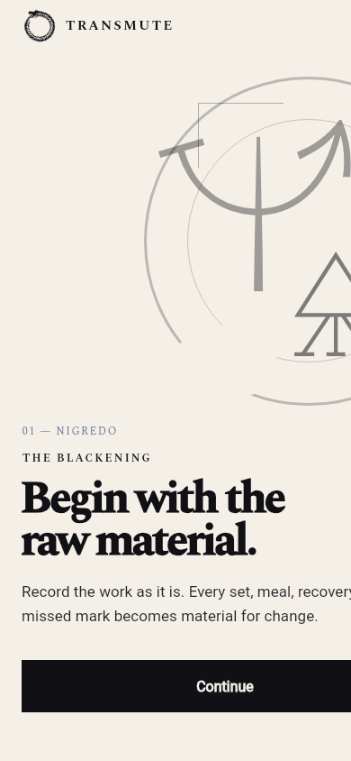
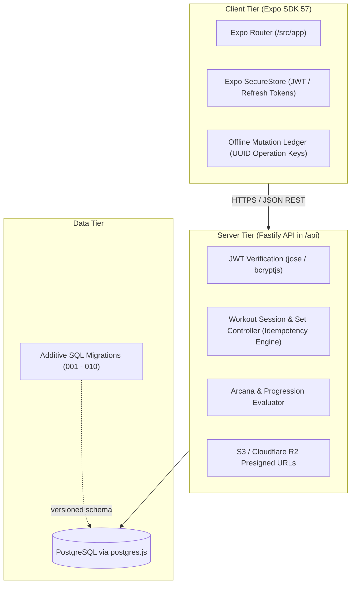

# Transmute

> Cross-platform strength and nutrition record system built with Expo (React Native), Fastify, and PostgreSQL.

[](https://expo.dev)
[](https://fastify.dev)
[](./api/migrations)
[](LICENSE)

Transmute is a universal training-record application designed around strict workout execution, idempotent mutation replay, and alchemical-themed progression milestones. The repository houses both the cross-platform Expo client (iOS, Android, and Web) and the standalone Fastify backend API that manages persistent storage, authentication, and training analytics.

---

## Visual Preview

| Desktop Web Experience | Touch-First Mobile Experience |
| :---: | :---: |
|  |  |
| *Adaptive web client layout* | *Mobile experience with dedicated bottom navigation* |

---

## Core Capabilities

- **Strict Training Lifecycle**: Guarantees a single active workout session invariant. Manages real-time set entry, rest timers stored as absolute UTC deadlines, and immutable historical completion logs.
- **Idempotent Offline Synchronization**: Supports logging sets while offline or on unstable gym Wi-Fi. The client generates unique UUID operation IDs, allowing the server to safely acknowledge or deduplicate replayed set mutations without duplicate records.
- **Flexible Prescription Modes**: First-class support for both repetition-based sets (`weightKg`, `reps`) and timed exercises (`targetDurationSeconds`, `loggedDurationSeconds`).
- **Arcana Milestone System**: Milestone achievements and rank threshold evaluations that track progression without regression risks.
- **Secure Native Storage**: Secure token storage via Expo SecureStore for iOS/Android and encrypted storage interfaces, utilizing rotating refresh tokens and short-lived JWT access tokens.

---

## System Architecture & Boundaries

The client and server maintain strict process and network isolation:



### Architectural Principles

1. **No Direct Client Database Access**: The Expo client never communicates directly with PostgreSQL, Cloudflare R2, or internal infrastructure. All operations pass through the validated `/v1` Fastify endpoints.
2. **Explicit Server Source of Truth**: Client optimistic state remains flagged as pending until verified by server acknowledgment.
3. **Dedicated Flutter Companion**: A standalone Flutter implementation ([`transmute-flutter`](https://github.com/jsalg-byte/transmute-flutter)) connects to the identical Fastify `/v1` API to demonstrate Riverpod Clean Architecture across web and desktop platforms.

---

## Repository Layout

```text
├── src/                    # Expo client source code (React Native 0.86 / React 19)
│   ├── app/                # Expo Router file-based navigation (iOS, Android, Web)
│   ├── components/         # Shared UI components and alchemical design tokens
│   └── lib/                # API transport, SecureStore helpers, and local cache
├── api/                    # Standalone Fastify backend API
│   ├── src/                # Fastify routes, controllers, and domain models
│   ├── migrations/         # Additive PostgreSQL migration scripts
│   └── dist/               # Compiled TypeScript production output
├── assets/                 # Icons, splash screens, and licensed alchemical SVGs
└── docs/                   # Architecture, PRD, and vertical slice specifications
```

---

## Local Development

### 1. Standalone Backend API

```sh
cd api

# Install dependencies
npm install

# Run database migrations against local Postgres instance
# (Migrations are executed in numerical sequence: 001 through 010)

# Start API in watch mode
npm run dev
```

The API will bind to `http://localhost:3000` (or configured `PORT`).

### 2. Expo Client Application

```sh
# From repository root
npm install

# Configure API endpoint (client-safe setting)
echo "EXPO_PUBLIC_API_BASE_URL=http://localhost:3000" > .env.local

# Start Expo development server
npm start
```

Target specific platforms:
- **Web**: `npm run web` (Accessible at `http://localhost:8081`)
- **iOS Simulator**: `npm run ios`
- **Android Emulator**: `npm run android`

---

## Database Migrations

Database schema changes are strictly additive and versioned under `api/migrations/`:

| Migration | Purpose |
| :--- | :--- |
| `001_core_schema.sql` | Users, authentication credentials, and profiles |
| `002_workout_plans.sql` | Workout routines, exercises, and target prescriptions |
| `003_sessions_and_sets.sql` | Active and completed session tracking |
| `004_nutrition.sql` | Meal logging and nutritional target tracking |
| `005_arcana_milestones.sql` | Progressive milestone unlock thresholds |
| `006_offline_set_sync.sql` | Session-scoped idempotency keys for offline set replay |
| `007_user_preferences.sql` | Units, display settings, and theme customization |
| `008_timed_exercises.sql` | Support for duration-based exercise targets |
| `009_shared_demos.sql` | Media catalog relationships for exercise demonstrations |
| `010_reverse_curl_demo.sql` | Bundled asset mapping for demonstration video playback |

---

## Automated Checks & Testing

Verify both the client and backend components:

```sh
# API Typecheck
npm --prefix api run typecheck

# API Unit & Domain Test Suites
npm --prefix api run test:arcana
npm --prefix api run test:workout-tracking
npm --prefix api run test:exercise-ranks

# API Production Build
npm --prefix api run build

# Client Static Analysis
npm run lint

# Client Static Web Export
npx expo export --platform web
```

---

## Production Deployment

The project is structured for dual-service deployment on Coolify or Docker Compose:

1. **Backend Service (`/api`)**:
   - Containerized via `api/Dockerfile` (Node.js 22 LTS alpine).
   - Configure environment: `DATABASE_URL`, `JWT_ACCESS_SECRET`, `AUTH_ISSUER`, and `CORS_ORIGINS`.
2. **Frontend Client (`/`)**:
   - Exported statically via `npx expo export --platform web` and served through Nginx.
   - Configure build argument: `EXPO_PUBLIC_API_BASE_URL=https://api.transmute.yourdomain.com`.

---

## License & Third-Party Notices

Licensed under the MIT License. See [LICENSE](LICENSE) for terms.
Third-party SVG assets and font attributions are detailed in [THIRD_PARTY_NOTICES.md](THIRD_PARTY_NOTICES.md).
